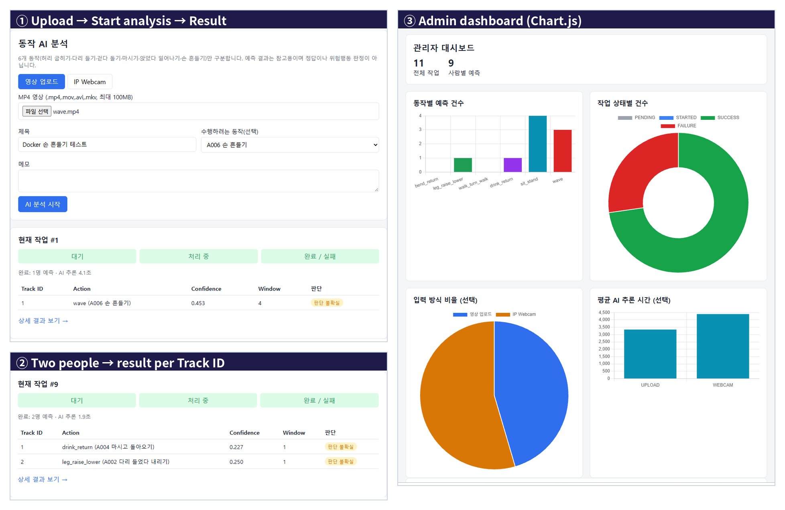
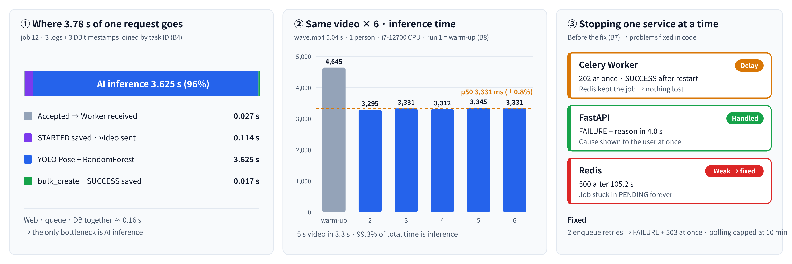
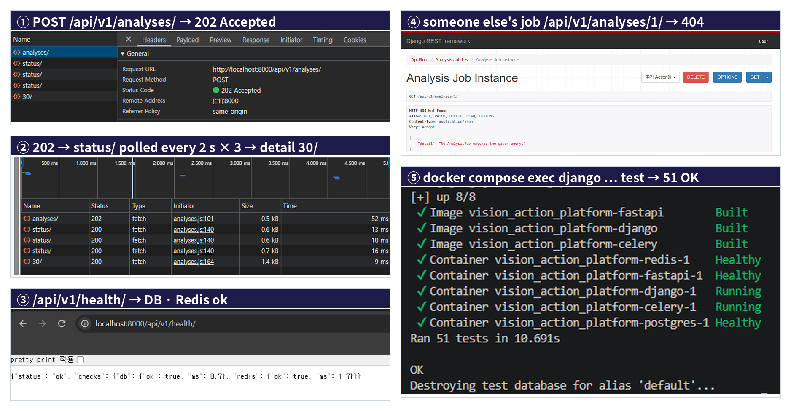

<div align="center">

# Vision Action Platform

**An AI web platform that predicts the action of each person in a video · Django / DRF · Celery / Redis · FastAPI · PostgreSQL**

</div>

<p align="right"><a href="README.md">한국어</a> | <b>English</b></p>

<p align="center">
       <br>
     
</p>

## Project Overview

### Architecture

Django · DRF validates each browser request, **saves the job as PENDING and returns 202 Accepted immediately**. Inference runs asynchronously through a **Redis message queue → Celery worker**; the worker sends the video to the FastAPI inference server, receives the **YOLO Pose → 38-D feature → 30 steps (1,140) → RandomForest** result and persists it to PostgreSQL. The client polls the status API every 2 s. FastAPI has no database access and returns JSON only. The 5 services are composed with **Docker Compose**.


*① → ⑧ request path · ⑨ → ⑫ persistence and read path · labels above arrows show the called function and payload format; blue dashed lines mark ORM writes. The bottom panels show the "AI 분석 시작" (Start analysis) call flow (file : line → function) and the endpoint table.*

**Request flow ("AI 분석 시작" · at 40d3916)**

```text
index.html:65 #start-btn ─▶ analyses.js:86 submit · :100 fetch(POST)
 ─▶ config/urls.py:9 "api/v1/" ─▶ config/api_urls.py:16 ─▶ analyses/api_urls.py:12 router
 ─▶ views.py:71 create() ─▶ serializers.py:47 validate ─▶ :76 save() = PENDING ─▶ :79 on_commit → :36 enqueue_analysis() ─▶ 202
 ─▶ Redis ─▶ tasks.py:88 run_analysis() ─▶ :34 _prepare_video() ─▶ services.py:19 predict_video() ──HTTP──▶
 ─▶ FastAPI predictions.py:33 ─▶ pose_pipeline.py:72 process_video() ─▶ multi_person_utils.py:11 feature_from_keypoints()
 ─▶ action_inference.py:60 predict_tracks() ─▶ 200 JSON ─▶ tasks.py:50 save_result() bulk_create = SUCCESS
 ─▶ analyses.js:128 poll() → views.py:119 status() ─▶ analyses.js:162 showResult()
```

| Service | Responsibility | Design decision |
|---|---|---|
| `django` | pages · REST API · input validation · job persistence · enqueue | 202 decoupled from inference · versioned `/api/v1/` · health check |
| `redis` | Celery broker (db0) · result backend (db1) | holds no business data (result keys store only `{job_id, status}`) |
| `celery` | video acquisition · inference call · result persistence | only the worker updates job status and inference results |
| `fastapi` | video → per-person prediction JSON | DB-independent · model swap by replacing files |
| `postgres` | job 1 : N per-person predictions | durable storage (survives restarts) |

Details: [architecture · code mapping](docs/architecture.md) · [API reference](docs/api.md) · [data model](docs/data-model.md) (Korean)

<br>

### Pipeline

Configuration → server startup → input → inference → persistence · read → verification, by file and function.


Details: [inference pipeline · model spec](docs/ai-inference.md)

<br>

### Summary

An AI web platform that classifies **6 actions per person (track)** in a video. Users submit a **video upload** or an **8-second phone IP Webcam capture** and receive a per-person label, confidence and all 6 class probabilities. The existing RandomForest model is served **without retraining**, and confidence below 0.55 is flagged as **"uncertain"**. Regular users see only their own jobs; administrators see all jobs through Django Admin and a dashboard.

After implementation, the backend was verified with **curl, logs, direct DB · Redis queries and fault injection**. One request was traced to the millisecond by task ID and services were stopped one at a time, producing 9 issues (F1 – F9). Fixes such as **Redis outage: 105 s hang → 503 · FAILURE within 16 s** are covered by 51 automated regression tests.

| ID | Action label | Action | ID | Action label | Action |
|---|---|---|---|---|---|
| A001 | `bend_return` | bend and return | A004 | `drink_return` | drink and return |
| A002 | `leg_raise_lower` | raise and lower leg | A005 | `sit_stand` | sit down and stand up |
| A003 | `walk_turn_walk` | walk, turn, walk | A006 | `wave` | wave hand |

<br>

### Key Results

| Area | Result |
|---|---|
| Service | **5 services** on Docker Compose · upload / IP Webcam input · **per-person (track)** results · role separation · admin dashboard · live IP Webcam preview |
| Async processing | job registration **202 in 0.18 s** · no wait on inference · status polling every 2 s · max 10 min |
| Performance | same video ×6 **p50 3.33 s (±0.8%)** · 5 s video processed in 3.3 s on CPU · **99.3% of time is inference** |
| Verification | functional scenarios **T01 – T10** · **9 API contract rules** · 3 fault injections · **51 automated tests passed** (PostgreSQL) |
| Improvements | issues **F1 – F9** · failure handling · observability (job logs) · API versioning · query optimization (admin list **27 → 7 queries**) |

<br>

### Screens



*① Upload → PENDING · STARTED · done stages, then the result table ② A two-person video stores results per track ID within one job ③ Admin dashboard: Django ORM aggregation → Chart.js (by action · status · input type · average inference time)*

<br>

### Backend Verification · Log Analysis

Behavior was verified against the design with **curl, logs, DB and Redis**, not the UI (B1 – B10).



**Request trace (job 12)** · The task ID issued by Django appears identically in the DB (`celery_task_id`) and the Celery log, joining three service logs and DB timestamps into one timeline.

| Time (KST) | Source | Event | Elapsed |
|---|---|---|---|
| 11:50:45.600 | DB `created_at` | request accepted · PENDING · **202** | — |
| 11:50:45.627 | celery log | `run_analysis[8d2e6411…] received` | +0.027 s |
| 11:50:45.700 | DB `started_at` | STARTED | +0.073 s |
| 11:50:49.366 | fastapi log | `wave.mp4: 126 frames, 1 tracks, 1 predictions, 3625 ms` | **+3.625 s (inference)** |
| 11:50:49.378 | DB `finished_at` | `bulk_create` · SUCCESS | +0.012 s |

Of the 3.78 s total, the bottleneck is inference.

**API contract · authorization** · anonymous 403 · register 202 · **another user's job 404** (existence not disclosed) · status cannot be changed via `PATCH` · `PUT` 405 · `DELETE` while running 409 → 204 after completion

**Fault injection (before fixes)**

| Stopped service | Client response | Job status | Verdict |
|---|---|---|---|
| Celery worker | 202 immediately | **SUCCESS** after recovery (message retained in Redis, zero loss) | delayed · UI waits indefinitely (F4) |
| FastAPI | 202 immediately | **FAILURE within 4.0 s** with reason | handled correctly |
| Redis | **500 after a 105.2 s hang** | **stuck PENDING** · delete 409 | weak point (F8 · F5 · F9) |

*These measurements predate consolidating the API under `/api/v1/`; only the prefix changed. Recaptured with the new paths:*



Details: [testing · backend analysis](docs/testing.md) · [execution evidence · raw logs](docs/evidence/README.md)

<br>

### Issue Analysis · Improvements

| Issue | Before | After | Verified by |
|---|---|---|---|
| Redis outage (F8 · F5) | 500 after a 105.2 s hang · stuck PENDING | `enqueue_analysis()` with 2 retries · **503 within 16.1 s · immediate FAILURE with reason** · recovers automatically | re-measured · 2 tests |
| Stuck jobs | delete 409 | delete allowed when `is_stale` (PENDING 10 min · STARTED time limit + 60 s) | 3 tests |
| Indefinite wait (F4) | polling has no exit condition | max 10 min · stops and notifies on a stuck job | re-measured · test |
| Observability (F1 · F2 · F3 · F7) | no success logs · no job ID in inference logs · mixed UTC / KST | `job#N` per-step durations · `X-Job-ID` header · KST `+0900` across 3 services | logs · 3 tests |
| API paths | split across `/api/` and `/accounts/api/` · hard-coded in JS | **single `/api/v1/` entry point** · `reverse()` · URLs injected by templates | 4 tests (legacy paths 404) |
| Health check | no healthcheck on the django service | `GET /api/v1/health/` checks DB · Redis (200 / 503) | 3 tests · compose healthy |
| Camera preview | capture view not visible | Django MJPEG relay `/cameras/<index>/stream/` · max 60 s · camera address hidden | 10 tests |
| Performance · structure | duplicated permission filter · N+1 queries | single `visible_to()` · `Count` aggregation → **admin list 27 → 7 queries · status 4 → 3** · 692 unused lines removed | 4 tests |
| Deduplication D1 – D5 | status badge, threshold, camera message and counting logic scattered | `_status_badge.html` · API `is_uncertain` · `CAMERA_CONNECT_FAILED` · `_count_by()` | 4 tests |

Automated tests went from 47 to **51**, all passing on Docker (PostgreSQL). Processing time was not re-measured after the fixes (no architectural change).

Details: [improvement history](docs/improvements.md) · [troubleshooting](docs/troubleshooting.md)

<br>

### Limitations · Next Steps

| Item | Detail |
|---|---|
| Training data | **1 subject (S01) · 1 clip per action · 6 clips total** (`rf_training_info.json`) → does not generalize to other people, clothing or camera angles |
| Generalization | wave by an unseen subject (S02) → `drink_return` **0.22** (near chance, 0.167) · identical to the training project's validation → a model limitation, not the serving code |
| Webcam input | stays `sit_stand` 0.31 – 0.34 across resolution, orientation and pose-confidence changes → not fixable in code without data |
| Mitigation | label shown with confidence · below 0.55 flagged **uncertain** · all 6 class probabilities stored |
| Next steps | collect multi-subject data · retrain and replace `ai_service/models/` (column-order and class checks reject a wrong model at startup) · for production: `DEBUG=False` · nginx · remove BasicAuth |

<br>

### Developer

| Name | Role | Scope |
|---|---|---|
| Sung Hyung Lee | Solo developer | requirements · DB design · Django / DRF API · Celery async processing · FastAPI inference server · Docker Compose · backend verification · fault testing · improvements · documentation |

<br>

### Quick Links

| Purpose | Documents (Korean) |
|---|---|
| Design | [architecture](docs/architecture.md) · [API reference](docs/api.md) · [data model](docs/data-model.md) · [inference pipeline](docs/ai-inference.md) |
| Operations | [run · operate](docs/operations.md) · [troubleshooting](docs/troubleshooting.md) |
| Verification | [testing · backend analysis](docs/testing.md) · [improvement history](docs/improvements.md) · [execution evidence](docs/evidence/README.md) |
| Model source | [yolo-pose-action-recognition-project](https://github.com/sunghyunglee/yolo-pose-action-recognition-project) |

<br><br>

## Quick Start

Requirements: Windows 11 + WSL2 Ubuntu + **Docker Desktop** (WSL integration enabled). Runs on CPU without a GPU.

**Step 1 · Clone**

```bash
git clone https://github.com/sunghyunglee/vision-action-platform.git
cd vision-action-platform
```

**Step 2 · Place the models** — the 2 large files are excluded from Git. Copy them from the training project's outputs.

| File | Location | Purpose |
|---|---|---|
| `rf_action_baseline.joblib` | `ai_service/models/` | 6-action RandomForest |
| `yolo11n-pose.pt` | `ai_service/models/` | 17-keypoint extraction (YOLO11 Pose) |

**Step 3 · Configure · run**

```bash
cp .env.example .env                # edit SECRET_KEY · DB password · IP Webcam URL
docker compose up --build -d        # start 5 services (migrate runs automatically)
docker compose ps                   # check postgres · redis · fastapi · django are healthy
docker compose exec django python manage.py createsuperuser
```

**Step 4 · Test**

```bash
docker compose exec django python manage.py test    # 51 tests · OK
```

| Page · API | URL |
|---|---|
| Analysis page (login required) | http://localhost:8000/ |
| Sign up · log in | http://localhost:8000/accounts/signup/ · /accounts/login/ |
| Admin dashboard · Admin | http://localhost:8000/dashboard/ · /admin/ |
| REST API · health check | http://localhost:8000/api/v1/analyses/ · /api/v1/health/ |
| FastAPI docs · status (local only) | http://localhost:8001/docs · /health |

Environment variables · logs · demo settings: [run · operate](docs/operations.md)

<br>

## Project Structure

```text
vision-action-platform/
├── backend/            Django · DRF + Celery worker (same image)
│   ├── config/         settings · urls · api_urls (/api/v1/) · health · celery
│   ├── accounts/       sign up · log in · /api/v1/auth/me/
│   ├── analyses/       models · serializers · views (API) · page_views (pages · dashboard)
│   │                   tasks (Celery) · services (FastAPI client) · camera_capture · stream_views · tests
│   └── templates/  static/
├── ai_service/         FastAPI inference server
│   ├── main.py  routers/predictions.py
│   ├── services/       model_loader · pose_pipeline · action_inference
│   ├── src/            pose · feature · sequence functions (same code as the training project)
│   └── models/         joblib · pt (not in Git) · feature order · training info
├── docs/               technical docs · images/ · diagrams/ (diagram generators) · evidence/ (execution logs)
└── compose.yaml  .env.example
```

<br>

## Notes

- **`.env`, `*.joblib`, `*.pt` and video files are excluded from Git.** Account passwords, camera addresses and cookie values are removed from captures and logs; faces are pixelated.
- **Demo settings** · `DJANGO_DEBUG=True` · BasicAuth enabled · Django serves `/media/` directly. Switch to `DEBUG=False` · nginx for production.
- IP Webcam uses only the addresses registered in `IP_WEBCAM_ALLOWED_URLS` in `.env`; the UI exposes camera numbers only.
- A predicted label is not ground truth or a risk assessment. Untrained actions may still be classified as one of the 6 classes.
- If a model-not-ready 503 occurs right after a PC reboot, run `docker compose restart fastapi` and retry.
