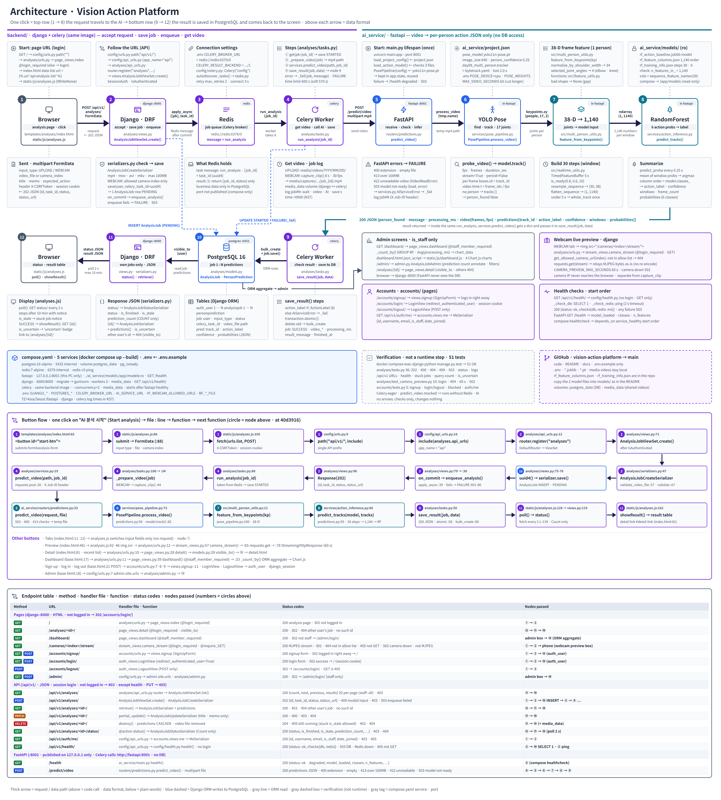
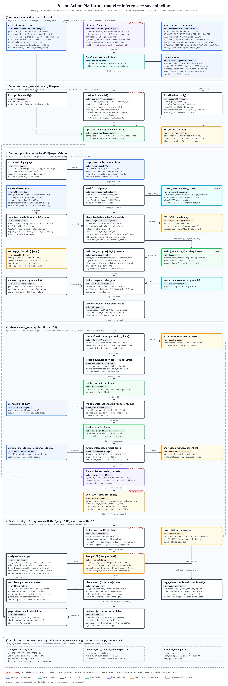

<div align="center">

# Vision Action Platform

**An AI web platform that predicts the action of each person in a video · Django / DRF · Celery / Redis · FastAPI · PostgreSQL**

</div>

<p align="right"><a href="README.md">한국어</a> | <b>English</b></p>

<p align="center">
       <br>
     
</p>

## At a glance

- **What** · Upload a video or record 8 seconds with a phone IP Webcam, and the platform returns one of 6 actions with a confidence score **for each person (track)** in the video.
- **How** · Django **saves the job as PENDING and answers 202 right away**. A Redis queue hands it to a Celery worker, which sends the video to FastAPI for **YOLO Pose → 38-D → 30 steps (1,140) → RandomForest** and stores the result in PostgreSQL. All 5 services start with one Docker Compose command.
- **What I did** · After building it, I took the backend apart with **curl, logs, DB, Redis and fault injection**. I split one request into milliseconds, stopped services one by one, found 9 issues (F1 – F9), fixed them (for example, **a Redis outage went from a 105 s hang to a 503 and FAILURE within 16 s**) and locked the fixes in with 51 automated tests.
- **Limit** · The model is reused as is and was trained on one person and 6 clips, so accuracy is low. Confidence below 0.55 is shown as **"uncertain"**.

<br>

## 1. Architecture



**How to read it** · The top row ① → ⑧ is the path of the request to the AI; the bottom row ⑨ → ⑫ is how the result is saved and comes back to the screen. Text above an arrow is the code call and data format; blue dashed lines are where the Django ORM writes to PostgreSQL. Below the diagram are the **button flow** (file : line → function) and the **endpoint table**.

**The code one click on "AI 분석 시작" (Start analysis) passes through** (at 40d3916)

```text
index.html:65 #start-btn ─▶ analyses.js:86 submit · :100 fetch(POST)
 ─▶ config/urls.py:9 "api/v1/" ─▶ config/api_urls.py:16 ─▶ analyses/api_urls.py:12 router
 ─▶ views.py:71 create() ─▶ serializers.py:47 validate ─▶ :76 save() = PENDING ─▶ :79 on_commit → :36 enqueue_analysis() ─▶ 202
 ─▶ Redis ─▶ tasks.py:88 run_analysis() ─▶ :34 _prepare_video() ─▶ services.py:19 predict_video() ──HTTP──▶
 ─▶ FastAPI predictions.py:33 ─▶ pose_pipeline.py:72 process_video() ─▶ multi_person_utils.py:11 feature_from_keypoints()
 ─▶ action_inference.py:60 predict_tracks() ─▶ 200 JSON ─▶ tasks.py:50 save_result() bulk_create = SUCCESS
 ─▶ analyses.js:128 poll() → views.py:119 status() ─▶ analyses.js:162 showResult()
```

| Service | Role | Key point |
|---|---|---|
| `django` | pages · DRF API · validation · save · enqueue | answers 202 without waiting for inference · single `/api/v1/` prefix · health check |
| `redis` | Celery broker db0 · results db1 | no business data (result keys hold only `{job_id, status}`) |
| `celery` | get video · call AI · save result | only the worker writes status and AI results |
| `fastapi` | video → per-person prediction JSON | no DB access · swap the model by replacing files |
| `postgres` | job 1 : N per-person predictions | survives restarts |

Details: [docs/architecture.md](docs/architecture.md) (per-button flows · architecture ↔ code check, in Korean) · [docs/api.md](docs/api.md) · [docs/data-model.md](docs/data-model.md)

<br>

## 2. Pipeline

<details>
<summary><b>Config files → server start → input → inference → save · display → verification (by file and function)</b></summary>

<br>



</details>

| Step | File · function | Input → output |
|---|---|---|
| Find and track people | `PosePipeline.process_video()` · YOLO11 Pose + ByteTrack | mp4 → joints (17, 2) per person |
| Frame feature | `feature_from_keypoints()` | (17, 2) → 38 (34 shoulder-width-normalized + 4 joint angles) |
| Window | `TimedFeatureBuffer` 5 s · every 0.25 s | valid features → (30, 38) → **1,140** |
| Action | `predict_tracks()` · RandomForest `predict_proba` | mean of 6 probabilities → label · confidence |

Details: [docs/ai-inference.md](docs/ai-inference.md)

<br>

## 3. Results (briefly)


| Area | Result |
|---|---|
| Features | upload and IP Webcam input · per-person (track) results · user permissions · admin dashboard · live IP Webcam preview · feature checks T01 – T10 |
| Response | job registration **202 in 0.18 s** · the browser polls only the status every 2 s (max 10 min) |
| Processing time | same video 6 times **p50 3.33 s (±0.8%)** · a 5 s video in 3.3 s on CPU · **99.3% of it is AI inference** |
| Verification | **51 automated tests passed** (PostgreSQL) · 9 API contract rules · 3 fault injections |

<br>

## 4. Backend analysis · logs

I checked "does it run as designed" not on screen but with **curl, logs, DB and Redis** (B1 – B10).


**① Tracing one request** · The task ID that Django creates up front is stored in the DB (`celery_task_id`) and appears in the Celery log, so the logs of three servers and the DB timestamps line up.

| Time (KST) | Source | Event | Elapsed |
|---|---|---|---|
| 11:50:45.600 | DB `created_at` | accepted · saved PENDING · **202** | — |
| 11:50:45.627 | celery log | `run_analysis[8d2e6411…] received` | +0.027 s |
| 11:50:45.700 | DB `started_at` | STARTED | +0.073 s |
| 11:50:49.366 | fastapi log | `wave.mp4: 126 frames, 1 tracks, 1 predictions, 3625 ms` | **+3.625 s (inference)** |
| 11:50:49.378 | DB `finished_at` | `bulk_create` · SUCCESS | +0.012 s |

Total 3.78 s · the only bottleneck is AI inference.

**② API contract · permissions** · no login 403 · register 202 · **another user's job 404** (hides that it exists, not 403) · `PATCH` on status leaves it unchanged · `PUT` 405 · `DELETE` while running 409 → 204 after it finishes

**③ Stopping services one by one (before the fixes)**

| Stopped | User response | Job status | Verdict |
|---|---|---|---|
| Celery worker | 202 at once | **SUCCESS** after recovery (Redis kept it, nothing lost) | delay only · screen waited forever meanwhile (F4) |
| FastAPI | 202 at once | **FAILURE in 4.0 s** with a reason | as designed |
| Redis | **500 after 105.2 s** | **PENDING forever** · delete also 409 | weakest point (F8 · F5 · F9) |

*These measurements were taken before the API moved to `/api/v1/`; only the prefix changed. Screens retaken with the new URLs:*


Details: [docs/testing.md](docs/testing.md) · raw logs [docs/evidence/](docs/evidence/README.md)

<br>

## 5. Fixes · before and after

| Finding | Before | After | Verified by |
|---|---|---|---|
| Redis outage (F8 · F5) | held 105.2 s then 500 · PENDING forever | `enqueue_analysis()` with 2 retries · **503 in 16.1 s · FAILURE with reason at once** · normal after recovery | re-measured · 2 tests |
| Stuck jobs | delete 409 | delete allowed when `is_stale` (PENDING 10 min · STARTED limit + 60 s) | 3 tests |
| Endless waiting (F4) | polling never ends | max 10 min · stops and explains on a stuck job | re-measured · test |
| Logs (F1 · F2 · F3 · F7) | no success logs · no job number in FastAPI · UTC / KST mixed | `job#N` step timings · `X-Job-ID` header · KST `+0900` in all three services | logs · 3 tests |
| API URLs | spread over `/api/` and `/accounts/api/` · hard-coded in JS | **single `/api/v1/`** · `reverse()` · template passes URLs | 4 tests (old URLs 404) |
| Health | only django had no healthcheck | `GET /api/v1/health/` checks DB and Redis (200 / 503) | 3 tests · compose healthy |
| Webcam | no way to see the camera view | Django MJPEG relay `/cameras/<index>/stream/` · max 60 s · address hidden | 10 tests |
| Optimization | duplicated permission filter · N+1 | one `visible_to()` · `Count` → **admin list 27 → 7 queries · status 4 → 3** · 692 unused lines removed | 4 tests |
| Dedupe D1 – D5 | badge HTML, threshold, camera message and counting in several places | `_status_badge.html` · API `is_uncertain` · `CAMERA_CONNECT_FAILED` · `_count_by()` | 4 tests |

Automated tests grew from 47 to **51** and all pass on Docker (PostgreSQL). Processing time was not re-measured after the fixes (no structural change).

Details: [docs/improvements.md](docs/improvements.md) · [docs/troubleshooting.md](docs/troubleshooting.md)

<br>

## 6. Summary · limits

- **Structure** · Accept (Django), queue (Redis), process (Celery), infer (FastAPI) and store (PostgreSQL) are separate, so heavy inference never blocks a web response.
- **Proof** · Linking logs and DB by task ID split one request into milliseconds; the only bottleneck was AI inference.
- **Fixes** · The Redis hang, permanent PENDING and endless waiting found by fault injection are now handled in code and covered by tests.

**Data limit (honestly)**

| Fact | Meaning |
|---|---|
| Training data = **one person (S01) · one clip per action · 6 clips** (`rf_training_info.json`) | does not generalize to other people, clothes or camera angles |
| A wave by an unseen person (S02) → `drink_return` **0.22** (about chance, 0.167) | the training project's own validation shows the same value → a model limit, not the web code |
| IP Webcam waves stay `sit_stand` 0.31 – 0.34 under changed conditions | code alone cannot raise it without data |

So the label is always shown with its confidence, and anything below 0.55 is marked **uncertain**. The next step is to retrain on data from many people and replace only the files in `ai_service/models/` (column-order and class checks block a wrong model at startup). Production would also need `DEBUG=False`, nginx and no BasicAuth.

<br>

## Quick start

Requirements: Windows 11 + WSL2 Ubuntu + **Docker Desktop** (WSL integration). Runs on CPU without a GPU.

```bash
git clone https://github.com/sunghyunglee/vision-action-platform.git
cd vision-action-platform

# The 2 model files are not in Git → copy them from the training project's outputs
cp <training project>/rf_action_baseline.joblib ai_service/models/
cp <training project>/yolo11n-pose.pt          ai_service/models/

cp .env.example .env                 # edit SECRET_KEY · DB password · IP Webcam URL
docker compose up --build -d         # 5 services (migrate runs automatically)
docker compose ps                    # postgres · redis · fastapi · django healthy
docker compose exec django python manage.py createsuperuser
docker compose exec django python manage.py test    # 51 tests · OK
```

| Page · API | URL |
|---|---|
| Analysis page (login required) | http://localhost:8000/ |
| Sign up · log in | http://localhost:8000/accounts/signup/ · /accounts/login/ |
| Admin dashboard · Admin | http://localhost:8000/dashboard/ · /admin/ |
| DRF API · health check | http://localhost:8000/api/v1/analyses/ · /api/v1/health/ |
| FastAPI docs · status (this PC only) | http://localhost:8001/docs · /health |

`.env` keys, reading logs and demo settings: [docs/operations.md](docs/operations.md)

<br>

## Documents (Korean)

| Document | Contents |
|---|---|
| [architecture.md](docs/architecture.md) | services · per-button flows (file : line) · architecture ↔ code check |
| [api.md](docs/api.md) | all endpoints · request / response examples · status codes |
| [data-model.md](docs/data-model.md) | ERD · tables · fields · `visible_to` permission · stuck-job rules |
| [ai-inference.md](docs/ai-inference.md) | model files · input format · YOLO Pose → 38-D → 30 steps → 1,140 → RF · data limits |
| [operations.md](docs/operations.md) | running · `.env` · 5 compose services · ports · volumes · health checks · logs |
| [testing.md](docs/testing.md) | 51 automated tests · backend analysis B1 – B10 · fault injection |
| [improvements.md](docs/improvements.md) | found → fixed → verified · fixes 2 – 6 · optimization · dedupe |
| [troubleshooting.md](docs/troubleshooting.md) | symptom · cause · fix · check |
| [evidence/](docs/evidence/README.md) | T01 – T10 evidence · logs · captures |

## Folder structure

```text
vision-action-platform/
├── backend/            Django · DRF + Celery worker (same image)
│   ├── config/         settings · urls · api_urls (/api/v1/) · health · celery
│   ├── accounts/       sign up · log in · /api/v1/auth/me/
│   ├── analyses/       models · serializers · views (API) · page_views (pages · dashboard)
│   │                   tasks (Celery) · services (FastAPI call) · camera_capture · stream_views · tests
│   └── templates/  static/
├── ai_service/         FastAPI inference server
│   ├── main.py  routers/predictions.py
│   ├── services/       model_loader · pose_pipeline · action_inference
│   ├── src/            pose · feature · sequence functions (same code as the training project)
│   └── models/         joblib · pt (not in Git) · feature order · training info
├── docs/               technical docs · images/ · diagrams/ (generators) · evidence/ (logs)
└── compose.yaml  .env.example
```

## Notes

- `.env`, `*.joblib`, `*.pt` and video files are not committed. Captures and logs contain no account passwords, camera addresses or cookie values, and faces are pixelated.
- **Demo settings** · `DJANGO_DEBUG=True` · BasicAuth allowed · Django serves `/media/` directly. Production: `DEBUG=False` · nginx.
- IP Webcam uses only the addresses in `IP_WEBCAM_ALLOWED_URLS` in `.env`; the page lets you pick a camera number only.
- A predicted label is not ground truth or a risk judgment. Untrained actions can still come out as one of the 6.
- If a model 503 appears right after a PC reboot, run `docker compose restart fastapi` and try again.

## Developer

| Name | Role | Work |
|---|---|---|
| Sung Hyung Lee | solo developer | requirements · DB design · Django / DRF API · Celery async · FastAPI inference server · Docker Compose · backend analysis · fault testing · fixes · docs |

Model source: [yolo-pose-action-recognition-project](https://github.com/sunghyunglee/yolo-pose-action-recognition-project)
