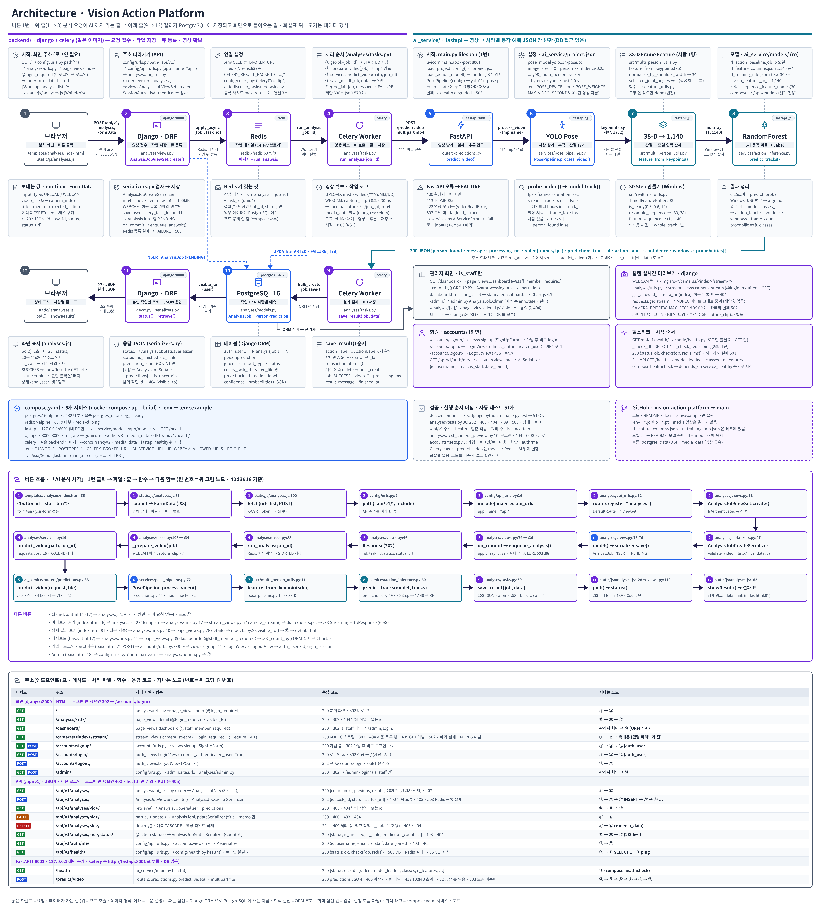
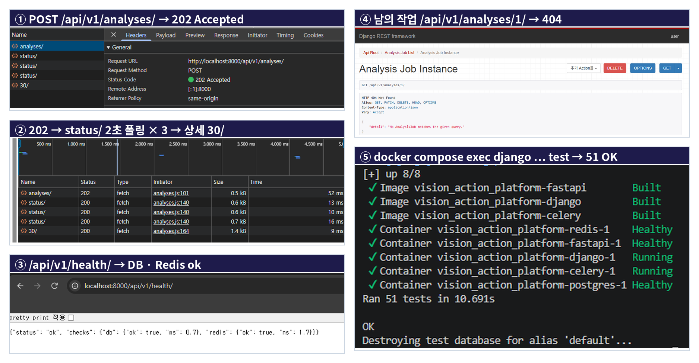

<div align="center">

# Vision Action Platform

**영상 속 사람마다 동작을 예측하는 AI 웹 플랫폼 · Django / DRF · Celery / Redis · FastAPI · PostgreSQL**

</div>

<p align="right"><b>한국어</b> | <a href="README.en.md">English</a></p>

<p align="center">
       <br>
     
</p>

## 프로젝트 소개

### Architecture

브라우저 요청은 Django · DRF 가 검증한 뒤 작업을 **PENDING 으로 저장하고 202 Accepted 로 즉시 응답**합니다. 추론은 **Redis 메시지 큐 → Celery Worker** 가 비동기로 처리하고, Worker 가 FastAPI 추론 서버에 영상을 전송해 **YOLO Pose → 38-D Feature → 30 Step (1,140) → RandomForest** 결과를 받아 PostgreSQL 에 저장합니다. 클라이언트는 2초 간격으로 상태 API 를 폴링합니다. FastAPI 는 DB 에 접근하지 않고 JSON 만 반환하며, 5개 서비스는 **Docker Compose** 로 구성합니다.



*① → ⑧ 요청 경로 · ⑨ → ⑫ 결과 저장 · 조회 경로 · 화살표 위는 호출 함수와 데이터 형식, 파란 점선은 ORM 쓰기 지점입니다. 하단에 「AI 분석 시작」 호출 흐름(파일 : 줄 → 함수)과 엔드포인트 표를 함께 실었습니다.*

**요청 처리 흐름 (「AI 분석 시작」 · 40d3916 기준)**

```text
index.html:65 #start-btn ─▶ analyses.js:86 submit · :100 fetch(POST)
 ─▶ config/urls.py:9 "api/v1/" ─▶ config/api_urls.py:16 ─▶ analyses/api_urls.py:12 router
 ─▶ views.py:71 create() ─▶ serializers.py:47 검증 ─▶ :76 save() = PENDING ─▶ :79 on_commit → :36 enqueue_analysis() ─▶ 202
 ─▶ Redis ─▶ tasks.py:88 run_analysis() ─▶ :34 _prepare_video() ─▶ services.py:19 predict_video() ──HTTP──▶
 ─▶ FastAPI predictions.py:33 ─▶ pose_pipeline.py:72 process_video() ─▶ multi_person_utils.py:11 feature_from_keypoints()
 ─▶ action_inference.py:60 predict_tracks() ─▶ 200 JSON ─▶ tasks.py:50 save_result() bulk_create = SUCCESS
 ─▶ analyses.js:128 poll() → views.py:119 status() ─▶ analyses.js:162 showResult()
```

| 서비스 | 역할 | 설계 포인트 |
|---|---|---|
| `django` | 화면 · REST API · 입력 검증 · 작업 저장 · 큐 등록 | 추론과 분리된 202 응답 · API 버전 `/api/v1/` · 헬스체크 |
| `redis` | Celery 브로커 (db0) · 결과 백엔드 (db1) | 업무 데이터 미보관 (결과 키는 `{job_id, status}` 만) |
| `celery` | 영상 확보 · 추론 서버 호출 · 결과 저장 | 작업 상태와 추론 결과는 Worker 만 갱신 |
| `fastapi` | 영상 → 사람별 예측 JSON | DB 비의존 · 모델 파일 교체만으로 모델 변경 |
| `postgres` | 작업 1 : N 사람별 예측 | 영속 저장 (재시작 후 유지) |

상세: [아키텍처 · 코드 대조](docs/architecture.md) · [API 명세](docs/api.md) · [데이터 모델](docs/data-model.md)

<br>

### Pipeline

설정 파일 → 서버 기동 → 입력 → 추론 → 저장 · 조회 → 검증 단계를 파일 · 함수 단위로 정리했습니다.


상세: [추론 파이프라인 · 모델 사양](docs/ai-inference.md)

<br>

### 개요

영상 속 **사람(Track)별로 6개 동작**을 분류하는 AI 웹 플랫폼입니다. 사용자는 **영상 업로드** 또는 **휴대폰 IP Webcam 8초 수집**으로 분석을 요청하고, 사람별 예측 Label · Confidence · 6개 Class 확률을 받습니다. 기존 RandomForest 모델은 **재학습 없이** 추론 서버로 서빙하고, Confidence 0.55 미만은 **「판단 불확실」** 로 표시합니다. 일반 회원은 본인 작업만, 관리자는 Django Admin 과 대시보드로 전체 작업을 조회합니다.

구현 이후 **curl · 로그 · DB · Redis 직접 조회와 장애 주입**으로 백엔드를 검증했습니다. task ID 로 요청 1건을 ms 단위로 추적하고 서비스를 하나씩 중단해 이슈 9건(F1 ~ F9)을 도출했으며, **Redis 장애 시 105초 응답 지연 → 16초 내 503 · FAILURE 처리** 등으로 개선한 뒤 자동 테스트 51개로 회귀를 방지했습니다.

| ID | Action Label | 동작 | ID | Action Label | 동작 |
|---|---|---|---|---|---|
| A001 | `bend_return` | 허리 굽혔다 펴기 | A004 | `drink_return` | 마시고 돌아오기 |
| A002 | `leg_raise_lower` | 다리 들었다 내리기 | A005 | `sit_stand` | 앉았다 일어나기 |
| A003 | `walk_turn_walk` | 걷다 돌아서 걷기 | A006 | `wave` | 손 흔들기 |

<br>

### 작업 결과

| 구분 | 핵심 결과 |
|---|---|
| 서비스 | Docker Compose **5개 서비스** · 업로드 / IP Webcam 입력 · **사람(Track)별 결과** 저장 · 권한 분리 · 관리자 대시보드 · IP Webcam 실시간 미리보기 |
| 비동기 처리 | 분석 등록 **202 · 0.18초** · 추론 대기 없이 응답 · 상태 폴링 2초 간격 · 최대 10분 |
| 처리 성능 | 동일 영상 6회 **p50 3.33초 (±0.8%)** · 5초 영상 CPU 3.3초 처리 · 전체 시간의 **99.3% 가 추론** |
| 검증 | 기능 시나리오 **T01 ~ T10** · API 계약 **9개 규칙** · 장애 주입 3종 · 자동 테스트 **51 passed** (PostgreSQL) |
| 개선 | 이슈 **F1 ~ F9** 도출 · 장애 처리 · 관측성(작업 로그) · API 버전 관리 · 쿼리 최적화 (Admin 목록 **27 → 7 쿼리**) |

<br>

### 작동 화면


*① 영상 업로드 → 대기 · 처리 중 · 완료 단계 표시 후 결과 표 출력 ② 두 사람 영상은 한 작업 안에 Track ID 별로 결과 저장 ③ 관리자 대시보드: Django ORM 집계 → Chart.js (동작별 · 상태별 · 입력 방식 · 평균 추론 시간)*

<br>

### 백엔드 검증 · 로그 분석

화면이 아닌 **curl · 로그 · DB · Redis** 로 설계대로 동작하는지 확인했습니다 (B1 ~ B10).


**요청 추적 (job 12)** · Django 가 발급한 task ID 가 DB `celery_task_id` 와 Celery 로그에 동일하게 남아, 세 서비스 로그와 DB 타임스탬프를 하나의 타임라인으로 연결했습니다.

| 시각 (KST) | 출처 | 이벤트 | 소요 |
|---|---|---|---|
| 11:50:45.600 | DB `created_at` | 요청 접수 · PENDING 저장 · **202** | — |
| 11:50:45.627 | celery 로그 | `run_analysis[8d2e6411…] received` | +0.027초 |
| 11:50:45.700 | DB `started_at` | STARTED | +0.073초 |
| 11:50:49.366 | fastapi 로그 | `wave.mp4: 126 frames, 1 tracks, 1 predictions, 3625 ms` | **+3.625초 (추론)** |
| 11:50:49.378 | DB `finished_at` | `bulk_create` · SUCCESS | +0.012초 |

총 3.78초 중 병목은 추론 구간입니다.

**API 계약 · 권한** · 비로그인 403 · 등록 202 · **타 사용자 작업 404** (존재 여부 비노출) · `PATCH` 로 상태 변경 불가 · `PUT` 405 · 처리 중 `DELETE` 409 → 완료 후 204

**장애 주입 (개선 전)**

| 중단 서비스 | 클라이언트 응답 | 작업 상태 | 판정 |
|---|---|---|---|
| Celery Worker | 202 즉시 | 복구 후 **SUCCESS** (Redis 메시지 보관, 유실 0) | 처리 지연 · 화면 무기한 대기 (F4) |
| FastAPI | 202 즉시 | **4.0초 내 FAILURE** + 사유 저장 | 정상 처리 |
| Redis | **105.2초 지연 후 500** | **PENDING 고착** · 삭제 409 | 취약 지점 (F8 · F5 · F9) |

*위 측정은 API 경로를 `/api/v1/` 로 통합하기 전에 수행했으며 변경 사항은 접두사뿐입니다. 아래는 신규 경로 기준 재캡처입니다.*



상세: [테스트 · 백엔드 분석](docs/testing.md) · [실행 증거 · 원본 로그](docs/evidence/README.md)

<br>

### 문제 분석 · 개선

| 이슈 | 개선 전 | 개선 후 | 검증 |
|---|---|---|---|
| Redis 장애 (F8 · F5) | 105.2초 응답 지연 후 500 · PENDING 고착 | `enqueue_analysis()` 재시도 2회 · **16.1초 내 503 · 즉시 FAILURE + 사유** · 복구 후 정상화 | 재측정 · 테스트 2개 |
| 고착 작업 | 삭제 409 | `is_stale` (PENDING 10분 · STARTED 제한 시간 + 60초) 시 삭제 허용 | 테스트 3개 |
| 무기한 대기 (F4) | 폴링 종료 조건 없음 | 최대 10분 · 고착 작업 감지 시 폴링 중단 · 안내 | 재측정 · 테스트 |
| 관측성 (F1 · F2 · F3 · F7) | 성공 로그 없음 · 추론 로그에 job 번호 없음 · UTC / KST 혼재 | `job#N` 단계별 소요 시간 · `X-Job-ID` 헤더 · 3개 서비스 KST `+0900` 통일 | 로그 · 테스트 3개 |
| API 경로 | `/api/` · `/accounts/api/` 분산 · JS 하드코딩 | **`/api/v1/` 단일 진입점** · `reverse()` · 템플릿에서 URL 주입 | 테스트 4개 (구 경로 404) |
| 헬스체크 | django 서비스 healthcheck 부재 | `GET /api/v1/health/` DB · Redis 점검 (200 / 503) | 테스트 3개 · compose healthy |
| 카메라 미리보기 | 촬영 화면 확인 불가 | Django MJPEG 중계 `/cameras/<index>/stream/` · 최대 60초 · 카메라 주소 비노출 | 테스트 10개 |
| 성능 · 구조 | 권한 필터 중복 · N+1 쿼리 | `visible_to()` 일원화 · `Count` 집계 → **Admin 목록 27 → 7 쿼리 · 상태 조회 4 → 3** · 미사용 코드 692줄 제거 | 테스트 4개 |
| 중복 제거 D1 ~ D5 | 상태 배지 · 판단 기준 · 카메라 문구 · 집계 로직 분산 | `_status_badge.html` · API `is_uncertain` · `CAMERA_CONNECT_FAILED` · `_count_by()` | 테스트 4개 |

자동 테스트 47개 → **51개**, Docker (PostgreSQL) 환경 전체 통과. 개선 후 처리 시간은 재측정하지 않았습니다 (아키텍처 변경 없음).

상세: [개선 이력](docs/improvements.md) · [트러블슈팅](docs/troubleshooting.md)

<br>

### 한계 · 향후 계획

| 항목 | 내용 |
|---|---|
| 학습 데이터 | **1명(S01) · 동작당 1클립 · 총 6클립** (`rf_training_info.json`) → 타 인물 · 복장 · 촬영 각도에 일반화되지 않음 |
| 일반화 검증 | 미학습 인물(S02) 손 흔들기 → `drink_return` **0.22** (무작위 기준 0.167 수준) · 학습 프로젝트 검증 결과와 동일 → 서빙 코드가 아닌 모델 한계 |
| 웹캠 입력 | 해상도 · 방향 · Pose conf 변경에도 `sit_stand` 0.31 ~ 0.34 → 데이터 없이 코드로 개선 불가 |
| 대응 | Label 과 Confidence 동시 표시 · 0.55 미만 **판단 불확실** · 6개 Class 확률 전체 저장 |
| 향후 계획 | 다인원 데이터 수집 · 재학습 후 `ai_service/models/` 교체 (컬럼 순서 · Class 검증으로 잘못된 모델은 기동 단계에서 차단) · 운영 전환 시 `DEBUG=False` · nginx · BasicAuth 제거 |

<br>

### 개발자 소개

| 이름 | 역할 | 담당 |
|---|---|---|
| 이성형<br>(Sung Hyung Lee) | 1인 개발 | 요구 분석 · DB 설계 · Django / DRF API · Celery 비동기 처리 · FastAPI 추론 서버 · Docker Compose · 백엔드 검증 · 장애 테스트 · 개선 · 문서화 |

<br>

### 바로가기

| 용도 | 문서 |
|---|---|
| 설계 | [아키텍처](docs/architecture.md) · [API 명세](docs/api.md) · [데이터 모델](docs/data-model.md) · [추론 파이프라인](docs/ai-inference.md) |
| 운영 | [실행 · 운영](docs/operations.md) · [트러블슈팅](docs/troubleshooting.md) |
| 검증 | [테스트 · 백엔드 분석](docs/testing.md) · [개선 이력](docs/improvements.md) · [실행 증거](docs/evidence/README.md) |
| 모델 출처 | [yolo-pose-action-recognition-project](https://github.com/sunghyunglee/yolo-pose-action-recognition-project) |

<br><br>

## 빠른 시작

요구 환경: Windows 11 + WSL2 Ubuntu + **Docker Desktop** (WSL integration 활성화). GPU 없이 CPU 로 동작합니다.

**1단계 · 저장소 받기**

```bash
git clone https://github.com/sunghyunglee/vision-action-platform.git
cd vision-action-platform
```

**2단계 · 모델 배치** — 대용량 파일 2개는 Git 에서 제외되어 있습니다. 학습 프로젝트 산출물에서 복사합니다.

| 파일 | 위치 | 용도 |
|---|---|---|
| `rf_action_baseline.joblib` | `ai_service/models/` | 6개 동작 RandomForest |
| `yolo11n-pose.pt` | `ai_service/models/` | 관절 17개 추출 (YOLO11 Pose) |

**3단계 · 설정 · 실행**

```bash
cp .env.example .env                # SECRET_KEY · DB 비밀번호 · IP Webcam 주소 수정
docker compose up --build -d        # 5개 서비스 기동 (migrate 자동 실행)
docker compose ps                   # postgres · redis · fastapi · django healthy 확인
docker compose exec django python manage.py createsuperuser
```

**4단계 · 테스트**

```bash
docker compose exec django python manage.py test    # 51 tests · OK
```

| 화면 · API | 주소 |
|---|---|
| 분석 화면 (로그인 필요) | http://localhost:8000/ |
| 회원가입 · 로그인 | http://localhost:8000/accounts/signup/ · /accounts/login/ |
| 관리자 대시보드 · Admin | http://localhost:8000/dashboard/ · /admin/ |
| REST API · 헬스체크 | http://localhost:8000/api/v1/analyses/ · /api/v1/health/ |
| FastAPI 문서 · 상태 (로컬 전용) | http://localhost:8001/docs · /health |

환경 변수 · 로그 확인 · 시연 설정: [실행 · 운영](docs/operations.md)

<br>

## 폴더 구조

```text
vision-action-platform/
├── backend/            Django · DRF + Celery Worker (동일 이미지)
│   ├── config/         settings · urls · api_urls (/api/v1/) · health · celery
│   ├── accounts/       회원가입 · 로그인 · /api/v1/auth/me/
│   ├── analyses/       models · serializers · views (API) · page_views (화면 · 대시보드)
│   │                   tasks (Celery) · services (FastAPI 호출) · camera_capture · stream_views · tests
│   └── templates/  static/
├── ai_service/         FastAPI 추론 서버
│   ├── main.py  routers/predictions.py
│   ├── services/       model_loader · pose_pipeline · action_inference
│   ├── src/            Pose · Feature · Sequence 함수 (학습 프로젝트와 동일 코드)
│   └── models/         joblib · pt (Git 제외) · Feature 순서 · 학습 정보
├── docs/               기술 문서 · images/ · diagrams/ (다이어그램 생성기) · evidence/ (실행 로그)
└── compose.yaml  .env.example
```

<br>

## 주의사항

- **`.env` · `*.joblib` · `*.pt` · 영상 파일은 Git 에 포함하지 않습니다.** 캡처 · 로그에서 계정 비밀번호 · 카메라 주소 · 쿠키 값은 제거했고, 인물 얼굴은 모자이크 처리했습니다.
- **시연용 설정** · `DJANGO_DEBUG=True` · BasicAuth 허용 · Django 의 `/media/` 직접 서빙. 운영 환경에서는 `DEBUG=False` · nginx 로 전환합니다.
- IP Webcam 은 `.env` 의 `IP_WEBCAM_ALLOWED_URLS` 에 등록한 주소만 사용하며, 화면에서는 카메라 번호만 선택합니다.
- 예측 Label 은 정답이나 위험행동 판정이 아닙니다. 학습하지 않은 동작도 6개 Class 중 하나로 분류될 수 있습니다.
- PC 재부팅 직후 모델 미준비 503 이 발생하면 `docker compose restart fastapi` 후 재시도합니다.
