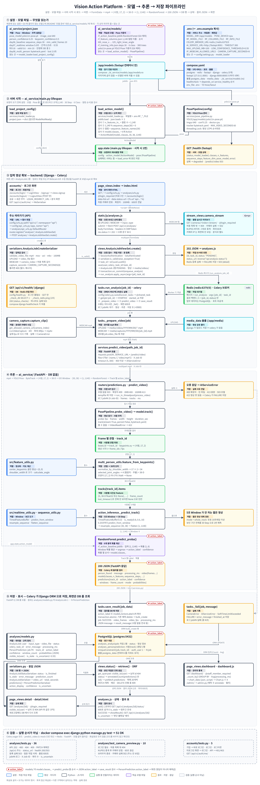
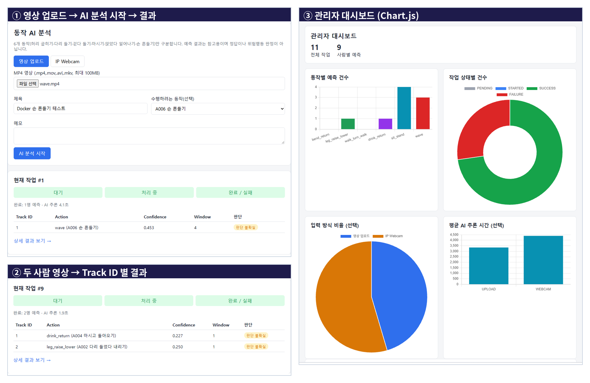
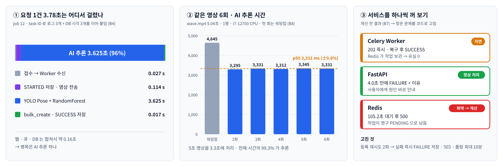

<div align="center">

# Vision Action Platform

**영상 속 사람마다 동작을 예측하는 AI 웹 플랫폼 · Django / DRF · Celery / Redis · FastAPI · PostgreSQL**

</div>

<p align="right"><b>한국어</b> | <a href="README.en.md">English</a></p>

<p align="center">
       <br>
     
</p>

## 한눈에

- **무엇을** · 영상을 올리거나 휴대폰 IP Webcam 으로 8초를 찍으면, 영상 속 **사람(Track)마다** 6개 동작 중 하나와 Confidence 를 돌려주는 웹 플랫폼입니다.
- **어떻게** · Django 가 요청을 **PENDING 으로 저장하고 202 로 바로 응답**하고, Redis 대기열 → Celery Worker 가 FastAPI 에 영상을 보내 **YOLO Pose → 38-D → 30 Step (1,140) → RandomForest** 결과를 받아 PostgreSQL 에 저장합니다. 5개 서비스는 Docker Compose 한 번으로 실행합니다.
- **무엇을 했나** · 만든 뒤 **curl · 로그 · DB · Redis · 장애 주입**으로 백엔드를 직접 뜯어봤습니다. 요청 1건을 ms 단위로 쪼개고 서비스를 하나씩 꺼 보며 문제 9개(F1 ~ F9)를 찾았고, **Redis 장애 시 105초 정체 → 16초 안에 503 · FAILURE** 등으로 고친 뒤 자동 테스트 51개로 확인했습니다.
- **한계** · 모델은 한 사람 · 클립 6개로 학습된 것을 그대로 써서 정확도는 낮습니다. 그래서 Confidence 0.55 미만은 **「판단 불확실」** 로 표시합니다.

<br>

## 1. Architecture


**그림 읽는 법** · 위 줄 ① → ⑧ 은 분석 요청이 AI 까지 가는 길, 아래 줄 ⑨ → ⑫ 는 결과가 저장되고 화면으로 돌아오는 길입니다. 화살표 위는 코드 호출과 데이터 형식, 파란 점선은 Django ORM 이 PostgreSQL 에 쓰는 지점입니다. 그림 아래에 **버튼 흐름**(파일 : 줄 → 함수)과 **주소 표**가 있습니다.

**「AI 분석 시작」 버튼 한 번이 지나는 코드** (40d3916)

```text
index.html:65 #start-btn ─▶ analyses.js:86 submit · :100 fetch(POST)
 ─▶ config/urls.py:9 "api/v1/" ─▶ config/api_urls.py:16 ─▶ analyses/api_urls.py:12 router
 ─▶ views.py:71 create() ─▶ serializers.py:47 검사 ─▶ :76 save() = PENDING ─▶ :79 on_commit → :36 enqueue_analysis() ─▶ 202
 ─▶ Redis ─▶ tasks.py:88 run_analysis() ─▶ :34 _prepare_video() ─▶ services.py:19 predict_video() ──HTTP──▶
 ─▶ FastAPI predictions.py:33 ─▶ pose_pipeline.py:72 process_video() ─▶ multi_person_utils.py:11 feature_from_keypoints()
 ─▶ action_inference.py:60 predict_tracks() ─▶ 200 JSON ─▶ tasks.py:50 save_result() bulk_create = SUCCESS
 ─▶ analyses.js:128 poll() → views.py:119 status() ─▶ analyses.js:162 showResult()
```

| 서비스 | 맡은 일 | 포인트 |
|---|---|---|
| `django` | 화면 · DRF API · 검사 · 저장 · 큐 등록 | 추론을 기다리지 않고 202 · `/api/v1/` 한 곳 · 헬스체크 |
| `redis` | Celery 브로커 db0 · 결과 db1 | 업무 데이터는 없음 (결과 키는 `{job_id, status}` 만) |
| `celery` | 영상 확보 · AI 호출 · 결과 저장 | 상태와 AI 결과는 Worker 만 씀 |
| `fastapi` | 영상 → 사람별 예측 JSON | DB 를 모름 · 모델 파일만 바꾸면 교체 |
| `postgres` | 작업 1 : N 사람별 예측 | 재시작해도 그대로 |

자세히: [docs/architecture.md](docs/architecture.md) (버튼별 흐름 · 아키텍처 ↔ 코드 대조표) · [docs/api.md](docs/api.md) · [docs/data-model.md](docs/data-model.md)

<br>

## 2. Pipeline

<details>
<summary><b>설정 파일 → 서버 시작 → 입력 → 추론 → 저장 · 표시 → 검증 (파일 · 함수 단위)</b></summary>

<br>



</details>

| 단계 | 파일 · 함수 | 입력 → 출력 |
|---|---|---|
| 사람 찾기 · 추적 | `PosePipeline.process_video()` · YOLO11 Pose + ByteTrack | mp4 → 사람마다 관절 (17, 2) |
| Frame Feature | `feature_from_keypoints()` | (17, 2) → 38 (어깨 너비 정규화 34 + 관절 각도 4) |
| Window | `TimedFeatureBuffer` 5초 · 0.25초마다 | 유효 Feature → (30, 38) → **1,140** |
| 동작 예측 | `predict_tracks()` · RandomForest `predict_proba` | 6개 확률 평균 → Label · Confidence |

자세히: [docs/ai-inference.md](docs/ai-inference.md)

<br>

## 3. 결과 (짧게)



| 구분 | 결과 |
|---|---|
| 기능 | 업로드 · IP Webcam 2가지 입력 · 사람(Track)별 결과 · 회원 권한 · 관리자 대시보드 · IP Webcam 실시간 미리보기 · 기능 확인 T01 ~ T10 |
| 응답 | 분석 등록 **202 · 0.18초** · 브라우저는 2초마다 상태만 확인 (최대 10분) |
| 처리 시간 | 같은 영상 6회 **p50 3.33초 (±0.8%)** · 5초 영상을 CPU 로 3.3초 · 그중 **99.3% 가 AI 추론** |
| 검증 | 자동 테스트 **51 passed** (PostgreSQL) · API 계약 9개 규칙 · 장애 주입 3종 |

<br>

## 4. 백엔드 분석 · 로그

"설계대로 도는가"를 화면이 아니라 **curl · 로그 · DB · Redis** 로 확인했습니다 (B1 ~ B10).



**① 요청 1건 추적** · Django 가 미리 만든 task ID 가 DB `celery_task_id` 와 Celery 로그에 똑같이 남아, 세 서버 로그와 DB 시각을 하나로 이었습니다.

| 시각 (KST) | 출처 | 일어난 일 | 걸린 시간 |
|---|---|---|---|
| 11:50:45.600 | DB `created_at` | 접수 · PENDING 저장 · **202** | — |
| 11:50:45.627 | celery 로그 | `run_analysis[8d2e6411…] received` | +0.027초 |
| 11:50:45.700 | DB `started_at` | STARTED | +0.073초 |
| 11:50:49.366 | fastapi 로그 | `wave.mp4: 126 frames, 1 tracks, 1 predictions, 3625 ms` | **+3.625초 (추론)** |
| 11:50:49.378 | DB `finished_at` | `bulk_create` · SUCCESS | +0.012초 |

합계 3.78초 · 병목은 AI 추론 하나였습니다.

**② API 계약 · 권한** · 로그인 없이 403 · 등록 202 · **남의 작업 404** (403 이 아니라 존재 자체를 숨김) · `PATCH` 로 상태를 바꿔도 값 그대로 · `PUT` 405 · 처리 중 `DELETE` 409 → 끝난 뒤 204

**③ 서비스를 하나씩 꺼 보기 (개선 전)**

| 꺼진 서비스 | 사용자 응답 | 작업 상태 | 평가 |
|---|---|---|---|
| Celery Worker | 202 즉시 | 복구 후 **SUCCESS** (Redis 가 보관, 유실 0) | 지연만 · 그동안 화면 무한 대기 (F4) |
| FastAPI | 202 즉시 | **4.0초 만에 FAILURE** + 이유 | 설계대로 |
| Redis | **105.2초 대기 후 500** | **영구 PENDING** · 삭제도 409 | 가장 취약 (F8 · F5 · F9) |

*이 측정은 주소를 `/api/v1/` 로 모으기 전에 했고, 바뀐 것은 접두사뿐입니다. 새 주소로 다시 찍은 화면은 아래와 같습니다.*


자세히: [docs/testing.md](docs/testing.md) · 원본 로그 [docs/evidence/](docs/evidence/README.md)

<br>

## 5. 개선 · 전후 비교

| 발견 | 개선 전 | 개선 후 | 확인 |
|---|---|---|---|
| Redis 장애 (F8 · F5) | 105.2초 붙잡힌 뒤 500 · 영구 PENDING | `enqueue_analysis()` 재시도 2회 · **16.1초에 503 · 바로 FAILURE + 이유** · 복구 뒤 정상 | 실제 재측정 · 테스트 2개 |
| 멈춘 작업 | 삭제 409 | `is_stale` (PENDING 10분 · STARTED 제한 + 60초) 이면 삭제 허용 | 테스트 3개 |
| 무한 대기 (F4) | 폴링에 끝이 없음 | 최대 10분 · 멈춘 작업이면 폴링 중지 · 안내 | 실제 재측정 · 테스트 |
| 로그 (F1 · F2 · F3 · F7) | 성공 로그 없음 · FastAPI 에 job 번호 없음 · UTC / KST 섞임 | `job#N` 단계별 시간 · `X-Job-ID` 헤더 · 세 서비스 KST `+0900` | 로그 · 테스트 3개 |
| API 주소 | `/api/` · `/accounts/api/` 흩어짐 · JS 하드코딩 | **`/api/v1/` 한 곳** · `reverse()` · 템플릿이 주소 전달 | 테스트 4개 (옛 주소 404) |
| 상태 확인 | django 만 healthcheck 없음 | `GET /api/v1/health/` DB · Redis (200 / 503) | 테스트 3개 · compose healthy |
| 웹캠 | 찍히는 모습을 볼 수 없음 | Django MJPEG 중계 `/cameras/<index>/stream/` · 최대 60초 · 주소 비노출 | 테스트 10개 |
| 최적화 | 권한 필터 중복 · N+1 | `visible_to()` 하나 · `Count` 집계 → **Admin 목록 27 → 7 쿼리 · 상태 조회 4 → 3** · 미사용 코드 692줄 삭제 | 테스트 4개 |
| 중복 정리 D1 ~ D5 | 배지 HTML · 판단 기준 · 카메라 문구 · 집계가 여러 곳 | `_status_badge.html` · API `is_uncertain` · `CAMERA_CONNECT_FAILED` · `_count_by()` | 테스트 4개 |

자동 테스트는 47개 → **51개**가 됐고 Docker(PostgreSQL)에서 모두 통과합니다. 개선 후 처리 시간은 다시 재지 않았습니다 (구조 변화 없음).

자세히: [docs/improvements.md](docs/improvements.md) · [docs/troubleshooting.md](docs/troubleshooting.md)

<br>

## 6. 정리 · 한계

- **구조** · 접수(Django) · 대기열(Redis) · 처리(Celery) · 추론(FastAPI) · 저장(PostgreSQL) 을 나눠 무거운 추론이 웹 응답을 막지 않습니다.
- **증명** · task ID 로 로그와 DB 를 이어 요청 1건을 ms 단위로 쪼갰고, 병목은 AI 추론 하나였습니다.
- **개선** · 장애 주입으로 찾은 Redis 정체 · 영구 PENDING · 무한 대기를 코드로 막고 테스트로 묶었습니다.

**데이터 한계 (정직하게)**

| 사실 | 의미 |
|---|---|
| 학습 데이터 = **한 사람(S01) · 동작당 1개 · 클립 6개** (`rf_training_info.json`) | 다른 사람 · 옷 · 카메라 각도에 일반화되지 않음 |
| 학습에 없던 사람(S02)의 손 흔들기 → `drink_return` **0.22** (무작위 0.167 수준) | 학습 프로젝트의 검증 결과에도 같은 값 → 웹 코드가 아니라 모델 한계 |
| IP Webcam 손 흔들기는 조건을 바꿔도 `sit_stand` 0.31 ~ 0.34 | 데이터 없이 코드로는 못 올림 |

그래서 Label 과 Confidence 를 함께 보여 주고 0.55 미만은 **판단 불확실**로 표시합니다. 다음 단계는 여러 사람 데이터로 다시 학습한 뒤 `ai_service/models/` 파일만 바꾸는 것입니다 (열 순서 · Class 검사가 잘못된 모델을 시작 단계에서 막음). 운영으로 가려면 `DEBUG=False` · nginx · BasicAuth 제거가 필요합니다.

<br>

## 빠른 시작

준비물: Windows 11 + WSL2 Ubuntu + **Docker Desktop** (WSL integration). GPU 없이 CPU 로 동작합니다.

```bash
git clone https://github.com/sunghyunglee/vision-action-platform.git
cd vision-action-platform

# 모델 2개는 Git 에 없음 → 학습 프로젝트 결과물에서 복사
cp <학습 프로젝트>/rf_action_baseline.joblib ai_service/models/
cp <학습 프로젝트>/yolo11n-pose.pt          ai_service/models/

cp .env.example .env                 # SECRET_KEY · DB 비밀번호 · IP Webcam 주소 수정
docker compose up --build -d         # 5개 서비스 (migrate 자동)
docker compose ps                    # postgres · redis · fastapi · django healthy
docker compose exec django python manage.py createsuperuser
docker compose exec django python manage.py test    # 51 tests · OK
```

| 화면 · API | 주소 |
|---|---|
| 분석 화면 (로그인 필요) | http://localhost:8000/ |
| 회원가입 · 로그인 | http://localhost:8000/accounts/signup/ · /accounts/login/ |
| 관리자 대시보드 · Admin | http://localhost:8000/dashboard/ · /admin/ |
| DRF API · 헬스체크 | http://localhost:8000/api/v1/analyses/ · /api/v1/health/ |
| FastAPI 문서 · 상태 (내 PC 에서만) | http://localhost:8001/docs · /health |

`.env` 항목 · 로그 읽기 · 시연 설정: [docs/operations.md](docs/operations.md)

<br>

## 문서

| 문서 | 내용 |
|---|---|
| [architecture.md](docs/architecture.md) | 서비스 구성 · 버튼별 흐름 (파일 : 줄) · 아키텍처 ↔ 코드 대조표 |
| [api.md](docs/api.md) | 모든 엔드포인트 · 요청 / 응답 예시 · 상태코드 |
| [data-model.md](docs/data-model.md) | ERD · 테이블 · 필드 · `visible_to` 권한 · 멈춘 작업 기준 |
| [ai-inference.md](docs/ai-inference.md) | 모델 파일 · 입력 형식 · YOLO Pose → 38-D → 30 Step → 1,140 → RF · 데이터 한계 |
| [operations.md](docs/operations.md) | 실행 · `.env` · compose 5개 서비스 · 포트 · 볼륨 · 헬스체크 · 로그 |
| [testing.md](docs/testing.md) | 자동 테스트 51개 · 백엔드 분석 B1 ~ B10 · 장애 주입 |
| [improvements.md](docs/improvements.md) | 발견 → 수정 → 확인 · 개선 2 ~ 6 · 최적화 · 중복 정리 |
| [troubleshooting.md](docs/troubleshooting.md) | 증상 · 원인 · 해결 · 확인 |
| [evidence/](docs/evidence/README.md) | T01 ~ T10 증거 · 로그 · 캡처 목록 |

## 폴더 구조

```text
vision-action-platform/
├── backend/            Django · DRF + Celery Worker (같은 이미지)
│   ├── config/         settings · urls · api_urls (/api/v1/) · health · celery
│   ├── accounts/       회원가입 · 로그인 · /api/v1/auth/me/
│   ├── analyses/       models · serializers · views (API) · page_views (화면 · 대시보드)
│   │                   tasks (Celery) · services (FastAPI 호출) · camera_capture · stream_views · tests
│   └── templates/  static/
├── ai_service/         FastAPI 추론 서버
│   ├── main.py  routers/predictions.py
│   ├── services/       model_loader · pose_pipeline · action_inference
│   ├── src/            Pose · Feature · Sequence 함수 (학습 프로젝트와 같은 코드)
│   └── models/         joblib · pt (Git 제외) · feature 순서 · 학습 정보
├── docs/               기술 문서 · images/ · diagrams/ (그림 생성기) · evidence/ (로그)
└── compose.yaml  .env.example
```

## 주의사항

- `.env` · `*.joblib` · `*.pt` · 영상 파일은 Git 에 올리지 않습니다. 캡처와 로그에는 계정 비밀번호 · 카메라 주소 · 쿠키 값이 없고, 사람 얼굴은 모자이크했습니다.
- **시연용 설정** · `DJANGO_DEBUG=True` · BasicAuth 허용 · Django 가 `/media/` 직접 제공. 운영은 `DEBUG=False` · nginx.
- IP Webcam 은 `.env` 의 `IP_WEBCAM_ALLOWED_URLS` 에 넣은 주소만 씁니다. 화면에서는 카메라 번호만 고릅니다.
- 예측 Label 은 정답이나 위험행동 판정이 아닙니다. 학습하지 않은 동작도 6개 중 하나로 나올 수 있습니다.
- PC 재부팅 직후 모델 503 이 나오면 `docker compose restart fastapi` 후 다시 시도합니다.

## 개발자

| 이름 | 역할 | 담당 |
|---|---|---|
| 이성형 (Sung Hyung Lee) | 1인 개발 | 요구 분석 · DB 설계 · Django / DRF API · Celery 비동기 · FastAPI 추론 서버 · Docker Compose · 백엔드 분석 · 장애 테스트 · 개선 · 문서 |

모델 출처: [yolo-pose-action-recognition-project](https://github.com/sunghyunglee/yolo-pose-action-recognition-project)
