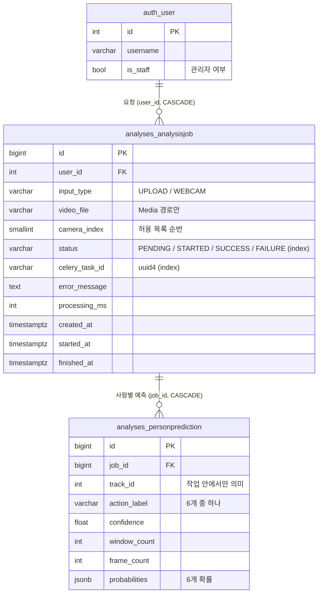

# Data Model

> 기준 코드: `backend/analyses/models.py` (40d3916)

## ERD



`(job, track_id)` 는 `UniqueConstraint("uniq_track_per_job")` · 두 사람이 나오는 영상이면 작업 1건에 예측 2행입니다.

## analyses_analysisjob (분석 1건)

| 필드 | 타입 | 누가 쓰나 | 설명 |
|---|---|---|---|
| `user` | FK → auth_user · CASCADE | Django (create) | 요청한 사람 |
| `title` · `memo` | varchar(100) · text | Django · PATCH | 사용자가 고칠 수 있는 유일한 값 |
| `input_type` | `UPLOAD` · `WEBCAM` | Django | 입력 방식 |
| `video_file` | FileField `videos/%Y/%m/%d/` | Django (업로드) · Celery (웹캠 수집 `captures/…/job_{id}.mp4`) | 영상은 `media_data` 볼륨, DB 에는 경로만 |
| `camera_index` · `capture_seconds` | smallint | Django | 카메라 **주소는 저장하지 않고** `IP_WEBCAM_ALLOWED_URLS` 순번만 · 수집 8초 |
| `expected_action` | 6개 Label 중 하나 | Django | 사용자가 하려던 동작 (정답 아님) |
| `status` | `PENDING` · `STARTED` · `SUCCESS` · `FAILURE` (index) | Django → Celery | Celery 상태 표기와 같은 대문자 |
| `celery_task_id` | varchar(64) (index) | Django (`uuid4`) | 로그 · Redis · DB 를 잇는 열쇠 |
| `error_message` · `result_message` | text · varchar(255) | Celery | 실패 이유 · FastAPI `message` |
| `video_frames` · `video_fps` · `video_duration_sec` · `processing_ms` | int · float | Celery (FastAPI 응답) | 영상 정보 · AI 추론 시간 |
| `created_at` · `started_at` · `finished_at` | timestamptz | Django · Celery | 접수 · Worker 시작 · 완료 (UTC 저장, 화면은 KST) |

계산 속성: `is_finished` (SUCCESS · FAILURE) · `is_stale` (아래) · `total_seconds` (접수 → 완료)

## analyses_personprediction (사람 1명당 1행)

| 필드 | 설명 |
|---|---|
| `track_id` | ByteTrack 번호. 그 영상 안에서만 의미 있고 영구 사람 ID 가 아님 |
| `action_label` | `ActionLabel` 6개 (`bend_return` · `leg_raise_lower` · `walk_turn_walk` · `drink_return` · `sit_stand` · `wave`). 밖의 값이 오면 `save_result()` 가 저장하지 않고 FAILURE |
| `confidence` | Window 평균 확률 중 최댓값 |
| `window_count` · `frame_count` | 예측에 쓴 Window 수 · 유효 Feature 프레임 수 |
| `probabilities` | 6개 Class 확률 JSON |

계산 속성: `is_uncertain` = `confidence < LOW_CONFIDENCE_THRESHOLD`(0.55)

## 권한: `visible_to(user)`

```python
class AnalysisJobQuerySet(models.QuerySet):
    def visible_to(self, user):
        return self if user.is_staff else self.filter(user=user)
```

| 쓰는 곳 | 결과 |
|---|---|
| `views.AnalysisJobViewSet.get_queryset()` (`views.py:54`) | API 목록 · 상세 · 상태 · 수정 · 삭제 모두 같은 범위 |
| `page_views.detail()` | 상세 화면도 같은 규칙 |
| 남의 작업 id | `get_object()` 가 범위 밖이라 **404** (403 이 아님 → 존재 여부를 숨김) |

이전에는 API 와 화면이 각자 `filter(user=…)` 를 썼습니다. 최적화 커밋 40dd39c 에서 한 곳으로 모았고 `test_visible_to` · `test_detail_page_and_api_follow_same_rule` 로 확인합니다.

## 상태와 멈춘 작업

```text
PENDING ──(Celery 가 꺼냄)──▶ STARTED ──▶ SUCCESS
   │                             └──────▶ FAILURE (AI 오류 · 카메라 실패 · Label 이상 · 제한 시간)
   └──(Redis 등록 실패)──────────────────▶ FAILURE + 503
```

`is_stale` (`models.py:93`)

| 상태 | 멈춘 것으로 보는 기준 |
|---|---|
| PENDING | `created_at` 부터 `PENDING_STALE_MINUTES`(10분) 초과 → Redis · Worker 문제로 영원히 대기 |
| STARTED | `started_at` 부터 `CELERY_TASK_TIME_LIMIT`(600초) + 60초 초과 → Worker 가 죽음 |

멈춘 작업은 삭제를 허용하고 (409 → 204), 화면은 폴링을 멈춥니다.

## 어디에 무엇이 남나

| 저장소 | 남는 것 | 수명 |
|---|---|---|
| PostgreSQL `postgres_data` 볼륨 | 회원 · 작업 · 사람별 예측 · 확률 | 영구 (5개 서비스 재시작 뒤에도 작업 22 · 예측 17 · 회원 2 유지, B9) |
| `media_data` 볼륨 | 업로드 · 수집 영상 | 작업 삭제 시 함께 삭제 |
| Redis db0 | 작업 메시지 (Worker 가 꺼내면 사라짐) | 조회 시 대기 0개 (B6) |
| Redis db1 | 결과 `{job_id, status}` | 1일 TTL |
